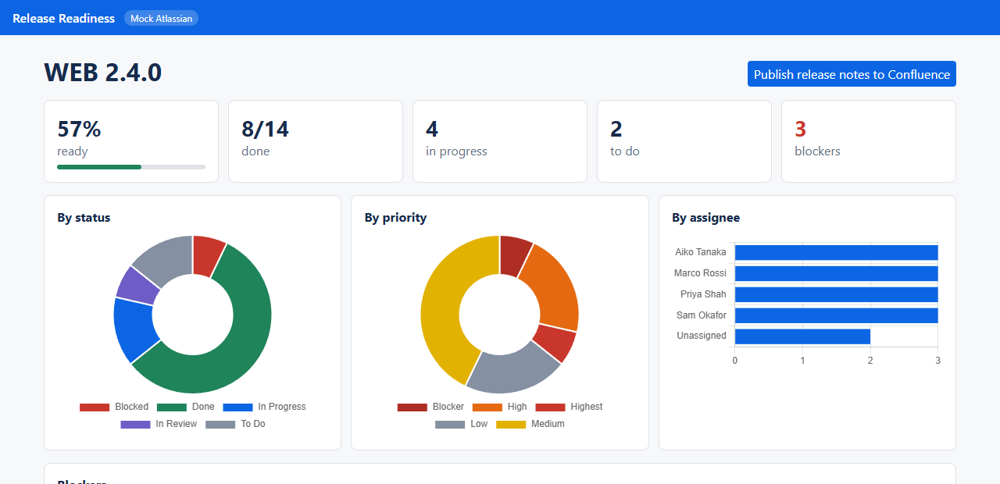
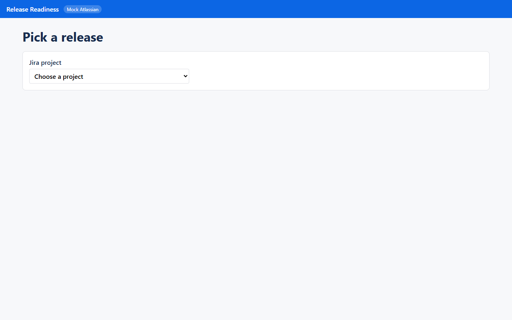
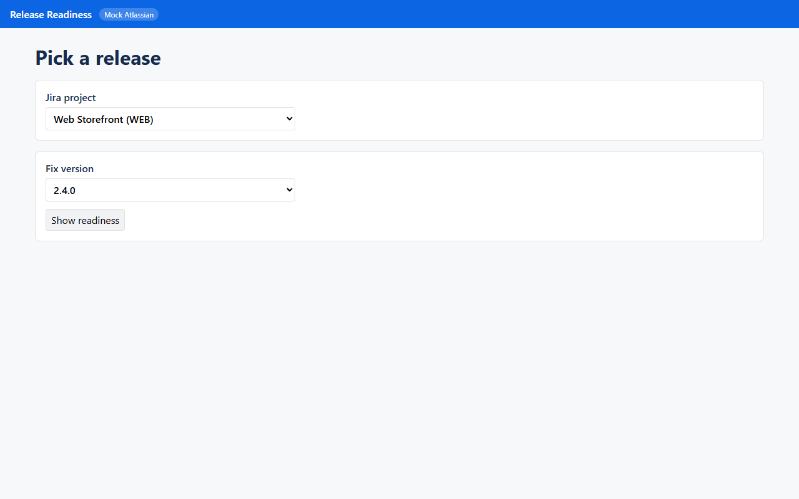
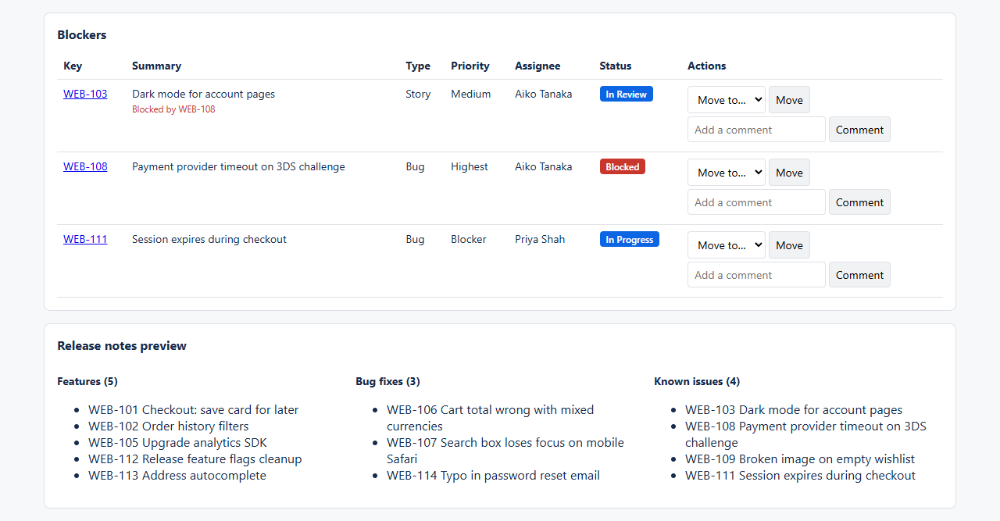
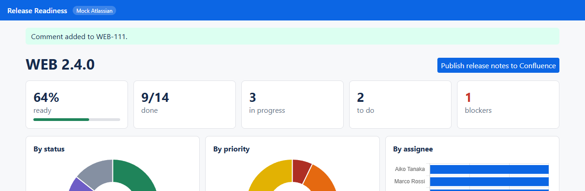
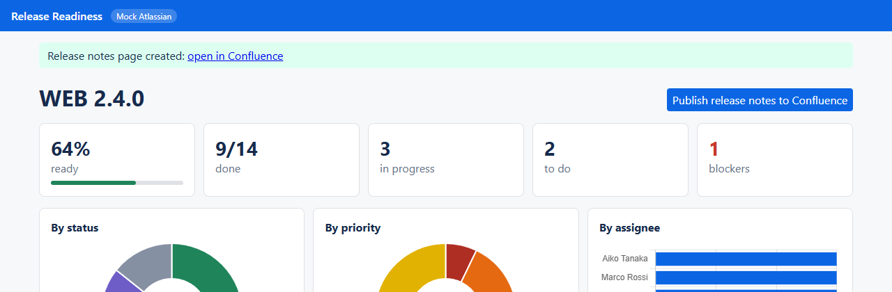
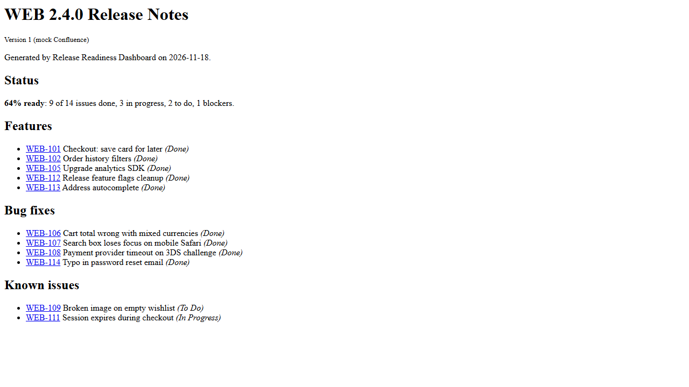
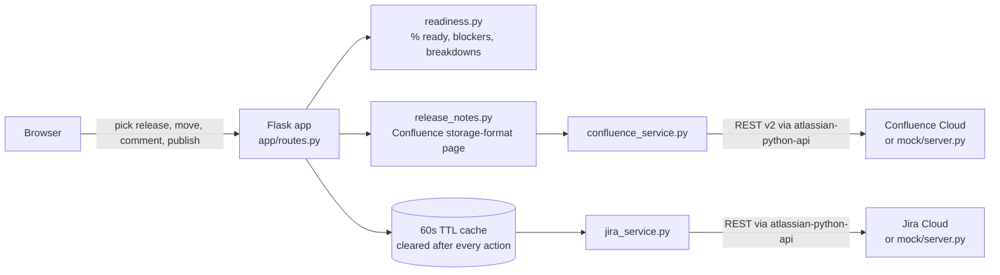

# Release Readiness Dashboard

A Flask app for team leads getting a release out the door. Pick a Jira project and fix version and it:

1. **Pulls from Jira** every issue in that fix version (Jira Cloud REST API, works on the free plan with an API token).
2. **Shows readiness**: a "% ready" score (share of issues in a Done status category), counts of done, in progress and to do, charts by status, priority and assignee, and a list of blockers.
3. **Takes actions**: move any ticket to another status or add a comment without leaving the app.
4. **Publishes to Confluence**: one click builds a release notes page (status, features, bug fixes, known issues) and creates it, or updates it if it already exists, through the Confluence Cloud REST API.

With no Atlassian credentials it runs against a built-in mock Jira + Confluence, so it works end to end out of the box.



## Why

Before a release, a lead usually has Jira open in one tab with a filter, a spreadsheet tracking what's left, and a Confluence page they're writing by hand. This app puts all three in one place: one page shows how close the release is and what is blocking it. You can unblock tickets from that page, and it writes the release notes for you from the same data.

## Walkthrough

Every screenshot below was taken from the app running in mock mode (`python run.py`, no credentials), so you can reproduce each step yourself.

### 1. Pick a project and fix version

The home page lists every Jira project your token can see. Choosing a project loads its fix versions (released ones are labelled).

| Pick a project | Pick a fix version |
| --- | --- |
|  |  |

### 2. See how ready the release is

The top of the release page has the headline numbers:

- **% ready**, with a progress bar
- **done / total**
- issues **in progress** and **to do**, from Jira's status categories
- **blockers**, shown in red when there are any

Below that are three charts: issues by status, by priority and by assignee. They show where the remaining work is and who has it.


### 3. Find the blockers and preview the notes

**Blockers** lists every open issue that is holding up the release (see [the rules](#how-readiness-is-scored)). Here, WEB-103 is in review but is linked as *blocked by* WEB-108, which is still open, so it counts as a blocker.

**Release notes preview** shows what will go to Confluence, already sorted into Features, Bug fixes and Known issues.



### 4. Act on tickets without leaving the page

Each row has a **Move to…** dropdown and a comment box. The dropdown only lists the transitions Jira allows for that issue, fetched the first time you open it. After an action, the app clears its cache and reloads the release, so the numbers update straight away.

Moving the blocker WEB-108 to Done raises readiness from 57% to 64% and drops blockers from 3 to 1. WEB-103 is no longer blocked by an open issue, so it leaves the list as well.

| Move a ticket | Add a comment |
| --- | --- |
|  |  |

### 5. Publish release notes to Confluence

**Publish release notes to Confluence** builds the page and creates it in the configured space. If a page called "&lt;PROJECT&gt; &lt;version&gt; Release Notes" already exists, it updates that page with a new version instead of creating a duplicate. The confirmation message links to the page.

| Confirmation | The Confluence page (mock) |
| --- | --- |
|  |  |

A full-length capture of the release page is in [docs/screenshots/dashboard.png](docs/screenshots/dashboard.png).

## How it works



- There is **no database**. Jira is the source of truth. Reads go through a small in-memory cache that lasts 60 seconds (`CACHE_SECONDS`), and every write clears it.
- **Mock mode** turns on when no credentials are set, or when `MOCK_MODE=1`. `run.py` then starts `mock/server.py` on port 5001. It speaks the same REST endpoints as Jira and Confluence Cloud, so the real client code runs unchanged over real HTTP.
- Charts use Chart.js from a CDN. If the CDN can't be reached, the rest of the page still works.

## Stack

| Concern | Choice |
| --- | --- |
| UI | Flask + Jinja templates |
| Jira / Confluence client | [atlassian-python-api](https://github.com/atlassian-api/atlassian-python-api) (Jira REST v2/v3, Confluence REST v2) |
| Charts | Chart.js 4 from the jsDelivr CDN |
| Storage | None: Jira is the source of truth, with a 60 second in-memory cache cleared after every action |
| Mocking | A small Flask app (`mock/server.py`) that speaks the same REST endpoints, so the real client code runs unchanged |

## Run it

```bash
python -m venv .venv && source .venv/bin/activate   # Windows: .venv\Scripts\activate
pip install -r requirements.txt
python run.py
```

Open http://127.0.0.1:5000. Without credentials the app starts in mock mode, with the fake Jira + Confluence on port 5001. A "Mock Atlassian" badge in the header shows when mock mode is on. Try project **Web Storefront**, version **2.4.0**.

## Connect real Jira and Confluence Cloud

1. Create a free Atlassian Cloud site with Jira and Confluence. Add a project with a fix version and a Confluence space (for example key `REL`).
2. Create an API token at https://id.atlassian.com/manage-profile/security/api-tokens.
3. Copy `.env.example` to `.env` and fill in:

```
ATLASSIAN_SITE=https://your-team.atlassian.net
ATLASSIAN_EMAIL=you@example.com
ATLASSIAN_API_TOKEN=...
CONFLUENCE_SPACE_KEY=REL
```

4. `python run.py`. Set `MOCK_MODE=1` to force the mock even with credentials present.

`.env` is git-ignored, so your token is never committed.

## How readiness is scored

- **% ready** = issues whose status category is Done ÷ all issues in the fix version.
- **Blockers** are open issues that are in a status containing "block", have priority Blocker or Highest, carry a `blocker` label, or are linked as "is blocked by" an issue that is not done.
- **Release notes**: done Stories/Tasks/Features go under Features, done Bugs under Bug fixes, and open Bugs or blockers under Known issues.

## Project layout

```
app/
  __init__.py            Flask app factory
  config.py              settings from env / .env, mock mode switch
  routes.py              pages, ticket actions, publish
  readiness.py           % ready, breakdowns, blocker rules
  release_notes.py       Confluence storage-format page builder
  cache.py               small TTL cache
  services/
    jira_service.py      Jira calls via atlassian-python-api
    confluence_service.py Confluence create-or-update via atlassian-python-api
  templates/, static/
mock/
  server.py              fake Jira + Confluence REST server
  seed.py, seed.json     demo projects, versions and issues
scripts/
  capture_screenshots.py regenerates docs/screenshots with Playwright
tests/                   unit tests + end-to-end tests against the mock
```

## Tests

```bash
pip install -r requirements-dev.txt
pytest
```

The end-to-end tests start the mock server on a free port and drive the Flask app, so every Jira and Confluence call goes through atlassian-python-api over real HTTP.

## Regenerating the screenshots

```bash
MOCK_MODE=1 python run.py            # in one terminal, fresh mock data
pip install playwright
python scripts/capture_screenshots.py docs/screenshots
```
